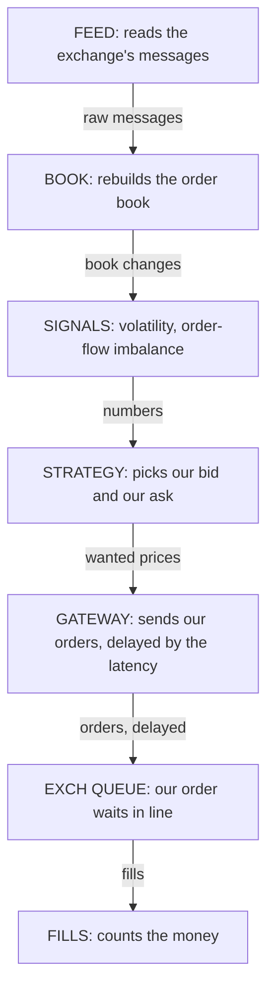
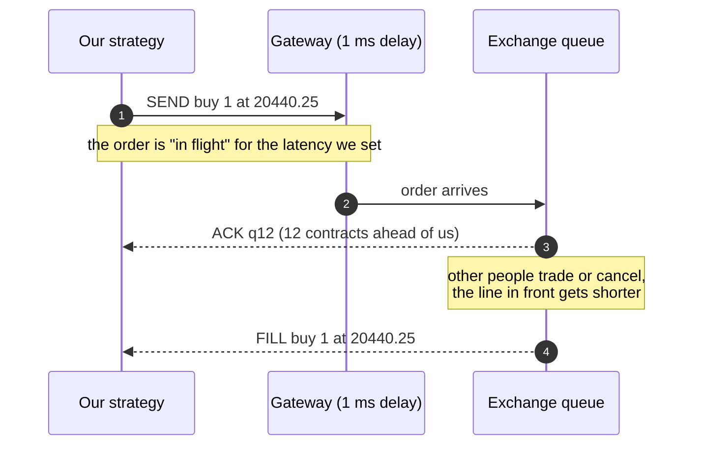
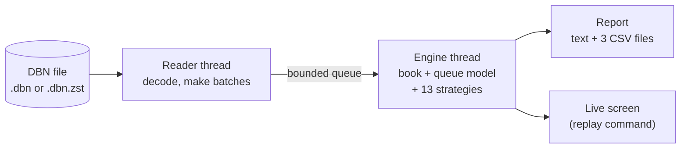

<div align="center">

# MM-Sim

### A pretend market maker, written in C++

It trades on recorded exchange data. A live screen shows how a real high-frequency firm runs its loop:<br>
read the market, show a buy price and a sell price, wait in line, get filled, count the money.


**[▶ Open the interactive guide](https://YOUR-USERNAME.github.io/mm_cpp/)**

[Why](#why-this-project-exists) · [The idea](#the-idea-in-one-minute) · [Play with it](#play-with-it) · [Quick start](#quick-start) · [Live screen](#what-the-live-screen-shows) · [Results and limits](#honest-results-and-limits) · [Developers](#for-developers)


<sub>The live screen replaying the small <b>made-up</b> sample file (one frame every 15 simulated seconds). The profits you see here are not a result: the file was generated so that quoting makes money.</sub>

</div>

---

## Why this project exists

Most forecasting projects ask one question: **where will the price go next?** That is very hard. My own order-flow forecast on NQ futures found no edge at 30 seconds.

High-frequency firms often ask a different question: **how do I get paid for simply being in the market?**
A *market maker* always shows two prices: one to buy at and one to sell at. Each time someone trades with them, they keep a small gap.
They do not need to know the direction. They need speed, a good place in the queue and tight control of risk.

I built MM-Sim to learn that whole idea by building it, with real exchange data:

| Goal | What it means in this project |
|---|---|
| **Learn** | See every moving part of a market-making loop and what each one costs: fees, waiting in line, delay, being picked off. |
| **Build** | Rebuild the exchange's order book message by message in C++, with tests, and prove it against a first version written in Python. |
| **See it like a real desk** | A live terminal screen that follows each message from the feed to the fill, using the same stages a real firm has. |
| **Stay honest** | It is a replay, not live trading, and it claims no edge. In an earlier Python run on 9 days of real NQ data, every strategy lost money. That is a result, not a bug, and it is the main lesson. See [Honest results and limits](#honest-results-and-limits). |

---

## The idea in one minute

An exchange keeps a list of waiting orders: buyers (**bids**) and sellers (**asks**).
The gap between the best bid and the best ask is the **spread**. A market maker puts one order on each side and earns the spread when both get traded.

Four things decide whether that makes money:

| Problem | In plain words | Try it |
|---|---|---|
| **Quote both sides** | Buy a little below the price, sell a little above. If both trade, you keep the gap. But a fee is paid on every trade, and it can eat the gap. | [Spread lab](https://YOUR-USERNAME.github.io/mm_cpp/#spread) |
| **Wait in line** | Many orders sit at one price and the exchange serves them first come, first served. A new order starts at the back. You are filled only when the orders in front are gone. | [Queue lab](https://YOUR-USERNAME.github.io/mm_cpp/#queue) |
| **Lean when you hold too much** | If you own a lot, the price might fall on you. So you move both prices down: your sell fills more easily, your buy less. This is the heart of the Avellaneda-Stoikov strategy. | [Lean lab](https://YOUR-USERNAME.github.io/mm_cpp/#lean) |
| **Do not get picked off** | Fast traders hit your price just before the market moves. You buy, then the price drops. This is called *adverse selection*, and it is the main danger. | [Spread lab](https://YOUR-USERNAME.github.io/mm_cpp/#spread) |

On top of that comes **delay**: your order needs time to arrive, and the market keeps moving. See the [Speed lab](https://YOUR-USERNAME.github.io/mm_cpp/#latency).

The program follows every market message through these stages, always in this order:



---

## Play with it

GitHub does not run scripts inside a README, so the sliders live on a small page hosted with GitHub Pages:

### **[▶ Open the interactive guide](https://YOUR-USERNAME.github.io/mm_cpp/)**

It has toy versions of the four ideas above (drag a slider, press a button, watch the graph change), a click-through of one message travelling down the pipeline, sample results, a glossary, and the run instructions with copy buttons.
It works in light and dark mode and on a phone. Below are snapshots of the same graphs, so you can see what is inside before you click.

**1. Money per fill: what is left after the price moves against you, and after the fee?**

<p align="center">
<a href="https://YOUR-USERNAME.github.io/mm_cpp/#spread">
<picture>
<source media="(prefers-color-scheme: dark)" srcset="docs/img/money-per-fill-dark.png">

</picture>
</a>
</p>

*Read it like this:* each fill earns half the spread. With a 2-tick spread that is 1 tick, $5.00 on NQ. In this snapshot the price then moves 0.3 tick against us (−$1.50) and the fee takes $2.00, so $1.50 is left. With a 1-tick spread you earn only $2.50, a $2 fee takes most of it, and a move of just 0.1 tick against you takes the rest. That is why queue position, cheap fees and avoiding bad fills decide everything.

**2. The queue: when do you get filled?**

<p align="center">
<a href="https://YOUR-USERNAME.github.io/mm_cpp/#queue">
<picture>
<source media="(prefers-color-scheme: dark)" srcset="docs/img/queue-dark.png">

</picture>
</a>
</p>

*Read it like this:* trades at your price use up the line in front of you, and cancels in front of you help too. A trade *through* your price (at a worse price for you) fills you first. An order ahead that raises its size goes to the back, so you move up; one that lowers its size keeps its place. The program uses these exact rules.

**3. Leaning against your inventory**

<p align="center">
<a href="https://YOUR-USERNAME.github.io/mm_cpp/#lean">
<picture>
<source media="(prefers-color-scheme: dark)" srcset="docs/img/lean-dark.png">

</picture>
</a>
</p>

*Read it like this:* the more contracts you hold, the lower both quotes move. The real program also sets the gap from data (volatility and how fast trades arrive) and never crosses the market.

**4. Delay: why speed matters**

<p align="center">
<a href="https://YOUR-USERNAME.github.io/mm_cpp/#latency">
<picture>
<source media="(prefers-color-scheme: dark)" srcset="docs/img/latency-dark.png">

</picture>
</a>
</p>

*Read it like this:* with 2,000 market messages a second and a 1 ms delay, the market has changed before your order lands about 86% of the time. A firm next to the exchange measures delay in microseconds. A home connection to Chicago is 100 ms or more.

---

## Quick start

You need the project folder, a C++ compiler and CMake. The only other code it uses, a small zstd decoder, is already in `third_party/`.
Do the steps in order. Each box is one command: paste it into the terminal and press Enter.

### Windows (PowerShell)

**Step 1. Get the project and open a terminal in it.** Click the green **Code** button on this page, then **Download ZIP**, and unzip it (for example to `D:\mm_cpp`). Or use `git clone https://github.com/YOUR-USERNAME/mm_cpp.git`.
Open the folder in File Explorer, click the address bar, type `powershell` and press Enter. Maximize the window: the live screen needs about **132 columns by 51 lines**.

```powershell
cd D:\mm_cpp
```

**Step 2. Build the program (once).** You need [CMake](https://cmake.org/download/) (tick "Add CMake to the PATH") and one compiler: [MinGW-w64](https://winlibs.com) is the easy one, or Visual Studio Build Tools with "Desktop development with C++". The script finds them and creates `bin\mm_sim.exe` and `bin\mm_tests.exe`.
No compiler? Download the ready-made Windows zip from the **Releases** page and skip this step.

```powershell
.\build.bat
```

**Step 3. Check that everything works.** It takes a few seconds and must end with `ALL TESTS PASSED`.

```powershell
.\bin\mm_tests.exe --file sample_data\sample_fake_nq.mbo.zst
```

**Step 4. Watch the live screen on the small sample.** The sample file is made up, so you can try freely.

```powershell
.\bin\mm_sim.exe replay sample_data\sample_fake_nq.mbo.zst --from 14:00
```

Keys: <kbd>SPACE</kbd> pause · <kbd>+</kbd> <kbd>-</kbd> slower / faster · <kbd>0</kbd> as fast as possible · <kbd>1</kbd> real time · <kbd>S</kbd> next strategy · <kbd>F</kbd> skip 1 minute · <kbd>G</kbd> skip 10 minutes · <kbd>Q</kbd> quit.

**Step 5. Watch your own NQ data.** The path can be the file or the folder that holds it. `--speed 10` plays ten times faster than real time.

```powershell
.\bin\mm_sim.exe replay "D:\tick data\NQ.c.0_mbo_20250510_20250522" --from 14:30 --speed 10
```

**Step 6. Run the full backtest.** It prints a report and saves three CSV files in a `results` folder. Expect a minute or two on real data.

```powershell
.\bin\mm_sim.exe "D:\tick data\NQ.c.0_mbo_20250510_20250522" --out results
```

**Step 7. Draw the charts.** The first line is needed only once. The picture is saved as `results\mm_results.png`.

```powershell
pip install pandas matplotlib
python tools\plot_results.py results
```

### Linux and macOS

```bash
sh ./build.sh                                                         # makes bin/mm_sim and bin/mm_tests
./bin/mm_tests --file sample_data/sample_fake_nq.mbo.zst              # must end with ALL TESTS PASSED
./bin/mm_sim replay sample_data/sample_fake_nq.mbo.zst --from 14:00   # live screen
./bin/mm_sim /path/to/your/data --out results                         # full backtest
```

Linux is tested. macOS should work (plain C++17 and POSIX) but I have not tried it.

> [!TIP]
> If the box lines look broken, add `--ascii`. If the window is too small, enlarge it or add `--ladder 4` (a shorter screen, 41 lines).
> Starting at `--from` first runs through the earlier data at full speed (a few seconds per day of NQ).

<details>
<summary><b>Where do I get real data?</b></summary>

<br>

The program reads **Databento MBO** files (market by order, schema `mbo`, dataset `GLBX.MDP3` for CME futures), plain `.dbn` or compressed `.dbn.zst`.
MBO is the most detailed kind of exchange data: one message per order added, changed or cancelled. That is what lets us rebuild the queue.

Other Databento files (trades, mbp-1) do not work, because they do not show the queue. The program says so if you give it one.
**Do not commit your data files to GitHub.** The licence usually forbids sharing them, and they are very large (`.gitignore` already skips `.dbn` and `.dbn.zst`).

</details>

---

## What the live screen shows



The right column of the screen (**OUR ORDERS**) is exactly this story, one line per step: `> SEND`, `+ ACK`, `* FILL`.

| Panel | What it shows | In a real firm, this is |
|---|---|---|
| **FEED** | messages per second, MB per second decoded, how much of the file is read | A network card (often with kernel bypass or an FPGA) receiving the exchange's **UDP multicast** market data (CME MDP 3.0), in a data centre next to the exchange (CME's is in Aurora), with hardware timestamps |
| **BOOK** | the order book, best bid and ask, how many orders are alive, our quotes with "(N ahead)" | The order-book builder that applies every update |
| **SIGNALS** | order-flow imbalance (OFI), volatility, and how fast trades arrive at each distance | Short-term signals recomputed on every update |
| **STRATEGY** | the bid and ask we want right now | The quoting logic. Usually the smallest piece of the code |
| **GATEWAY** | orders "in flight" for the latency we set | The order-entry connection (CME iLink 3), with **risk checks** and a **kill switch** before every order |
| **EXCH QUEUE** | how many orders are ahead of ours | The exchange's matching engine. CME index futures match first-in, first-out at one price, so queue position is what you trade |
| **FILLS** | fills, inventory, profit after fees | Execution reports coming back and updating position and risk |
| **OUR CODE: TIME/MSG** | how long our own code takes per message | "Tick-to-trade" latency, which every firm measures end to end |

Same habits as a real low-latency system, on a small scale: the hot path never allocates memory, the book is flat arrays, orders live in a hash table, and decoding the file runs on its own thread.

> [!NOTE]
> What is **not** the same: there is no network, no exchange and no real acknowledgement. The latency is a number we choose (default 1 ms), and the "time per message" figures are this program's own compute time on your computer.

---

## Strategies

Every strategy quotes **one contract on each side** and is simulated alone on the same data.

| Name | In plain words |
|---|---|
| **Join** | Sit at the best bid and the best ask. Simple, and the baseline. |
| **A-S** (Avellaneda-Stoikov) | Move both quotes against your inventory, and set the gap from volatility and how fast trades arrive. |
| **GLFT** (Guéant-Lehalle-Fernandez-Tapia) | A relative of A-S that treats the inventory limit more carefully. |
| **… + OFI** | Any of the above, plus a defence: when order-flow imbalance says one side is about to be run over, pull the quote on that side. |

The full report also runs Join and A-S that re-quote every 10 ms and 1 ms, and A-S with 5, 20 and 50 ms of delay. That makes **13 runs** in total. If the profit disappears when you add 5 ms of delay, the edge was never yours.

---

## Reading the results

The report prints to the screen (between `PASTE FROM HERE` and `PASTE UNTIL HERE` lines, so you can copy it into a chat or an issue) and the program saves three files: `mm_summary.csv` (one row per strategy), `mm_daily.csv` (profit per day) and `mm_equity.csv` (profit over time).

What to look at first:

1. **Net after fees**, per strategy and per day. Does it win on most days?
2. **Markouts**: how many ticks the price moved in your favour *after* a fill (at the fill, +1 s, +5 s, +30 s). If the number falls as time passes, you were picked off.
3. **Average inventory.** A strategy that earns by carrying a big position is betting on direction, not making a market.
4. **The fee what-if.** It shows the fee at which each strategy breaks even. Big firms pay far less than retail.
5. **The latency and re-quote tables.** Edge that disappears at 5 ms was never yours.

<details>
<summary><b>Sample run: profit over time (made-up data, do not quote these numbers)</b></summary>

<br>

> [!WARNING]
> The sample file was generated so that quoting makes money. This graph shows what the output *looks like*. It proves nothing about real markets.

<p align="center">
<picture>
<source media="(prefers-color-scheme: dark)" srcset="docs/img/profit-dark.png">

</picture>
</p>

</details>

---

## Honest results and limits

> [!WARNING]
> **On real NQ data, an earlier Python run lost money for every strategy.** After each fill the price tends to move against us (*adverse selection*), and the markout table shows it. This C++ version reproduces the same simulation, faster. It does not add an edge.

* **The sample file is synthetic.** Strategies earn money on it because it was generated that way. It is a test file, not a result.
* **It is a replay, not a live connection.** Nothing here sends an order to CME.
* **The queue model is an assumption.** We join the back of the line, and our orders never change what others do. In real markets they do, and that cannot be measured from old data.
* **Latency is one fixed number.** Real latency varies and spikes.
* **One instrument at a time:** the one with the most trades at the start of the file. Others are ignored.
* **Open questions, not missing code:** cheaper fees, a real signal, and other products. For a stock or MNQ, set `--tick`, `--tick-value` and `--fee`.

---

## How we know it is correct

1. **Same answers as the Python version, fill by fill.** `tools/parity.py` runs one file through both engines and compares every fill of all 13 strategies (time, price, size, side) and the summary numbers. Result: **identical**, on the small sample (194,124 records) and on a 453 MB file (8.1 million records, about 600,000 fills per strategy), with and without trading hours.
2. **76 self-checks** (`mm_tests`): the queue rules step by step (a trade at our price fills us only after the queue ahead is used up; a modify down keeps priority, up loses it; a trade through our price fills us first; a post-only order that would cross is rejected; the OFI defence pulls the right side), the hash table against `std::unordered_map`, the order book against a slow brute-force rebuild at 104,071 moments (0 mismatches), cash and inventory against the list of fills, the inventory limit, and plain files against compressed ones.
3. **No peeking ahead.** The first 55% of a file gives exactly the same fills with or without the rest. Volatility and the other estimates only use past data.
4. **The tests can fail.** I planted two bugs on purpose (a flipped OFI sign, a queue that never moves up). The tests caught both.
5. **Windows.** The Windows `.exe` gave byte-identical files to the Linux build when run under Wine (apart from Windows line endings). I have not run it on a real Windows machine, and the Visual Studio route of `build.bat` is set up but untested. On another compiler, a rare last-digit difference in the results is possible (floating-point maths); it is not a bug.
6. **Speed.** About **3 million records per second** with 13 strategies on 2 cores (the Python/Numba version: about 1.5 million). A full NQ file of about 125 million records should take a minute or two, but real books are deeper than my fake file, so I do not promise a number.

---

## For developers

<details>
<summary><b>Project layout</b></summary>

<br>

| Path | What it is |
|---|---|
| `src/engine.hpp` | The simulator core: order book, queue model, strategies, calibration. A port of `mm_engine.py` |
| `src/dbn.hpp`, `third_party/zstd/` | The DBN reader (plain or zstd) and a vendored zstd decoder |
| `src/order_map.hpp` | Order-id hash table (open addressing) |
| `src/feed.hpp`, `src/backtest.hpp` | Reader thread, engine thread, instrument pick, the full run |
| `src/report.hpp` | Per-day profit, markouts, the printed report, the CSV files |
| `src/dashboard.cpp` | The live screen |
| `src/settings.hpp`, `src/main.cpp` | Options and commands |
| `tests/test_main.cpp` | The self-checks |
| `tools/parity.py`, `tools/plot_results.py` | Python-versus-C++ check; charts from the CSV files |
| `reference_python/` | The Python/Numba version this was ported from |
| `sample_data/` | A small made-up MBO file |
| `docs/` | The interactive guide (`index.html`) and the images used in this README |

</details>

<details>
<summary><b>How it works inside</b></summary>

<br>

* **Book.** An L3 book (every order tracked): price-level arrays on a 1,048,576-tick grid, plus an open-addressing hash map from order id to order. The best price is found with block counters, so it is fast.
* **Queue model.** Our order joins the back of the queue and keeps two numbers: how many contracts are ahead of it, and how much has traded. A trade at our price eats the line in front first. A trade through our price fills us at once. A modify down keeps priority; a modify up loses it. Orders go through a latency queue and are rejected if a post-only order would cross. Positions are flattened outside trading hours.
* **Strategies.** Join, Avellaneda-Stoikov and GLFT, each with an optional OFI defence. The skew is scale-free. Volatility, the trade-arrival rate A and the decay k are re-calibrated every 60 s from the last 600 s.
* **Threads.** A reader thread decodes the file and hands batches to the engine thread through a bounded queue. The hot path (`Engine::on_msg`) does not allocate.



</details>

<details>
<summary><b>Maintainers: turn on the guide page (GitHub Pages)</b></summary>

<br>

The interactive guide is the single file `docs/index.html`. To publish it:

1. On GitHub open **Settings → Pages**.
2. Under **Build and deployment** choose **Deploy from a branch**, pick branch `main` and the folder `/docs`, and press **Save**.
3. After a minute the guide is live at `https://YOUR-USERNAME.github.io/mm_cpp/`. Replace `YOUR-USERNAME` (and the repository name, if you changed it) in this README.

To rebuild the ready-made Windows zip for the **Releases** page, zip `bin\mm_sim.exe`, `bin\mm_tests.exe`, `sample_data\` and `tools\` after running `build.bat`.

</details>

<details>
<summary><b>Build, test and check against Python</b></summary>

<br>

```bash
cmake -S . -B build -DCMAKE_BUILD_TYPE=Release
cmake --build build -j
./build/mm_tests                                               # hand-made cases only
./build/mm_tests --file sample_data/sample_fake_nq.mbo.zst     # adds the data-file checks
```

To repeat the parity check you need Python with numpy, pandas, numba and databento (`pip install -r reference_python/requirements.txt`):

```bash
python tools/parity.py sample_data/sample_fake_nq.mbo.zst ./build/mm_sim
python tools/parity.py sample_data/sample_fake_nq.mbo.zst ./build/mm_sim --hours   # also tests the flatten-at-close path
```

It prints one line per strategy and ends with `PARITY: OK`. To make a bigger synthetic file: `python reference_python/tests/make_fake_mbo.py big.mbo 0.4 2500000 2`.

The check that compares a plain file with a compressed one needs both: `mm_tests --file x.mbo --zst x.mbo.zst`.

</details>

<details>
<summary><b>All options</b></summary>

<br>

Everything can be a command-line option (`--tick 0.01`) or a line in `mm_settings.txt` (`tick = 0.01`; start from `mm_settings.example.txt`). The command line wins. `--config other.txt` loads another file.

| Option | Default | Meaning |
|---|---|---|
| `--tick` / `--tick-value` | 0.25 / 5 | Price step and dollars per tick per unit. NQ: 0.25 / 5. MNQ: 0.25 / 0.5. A stock: 0.01 / 0.01 |
| `--fee` | 2 | Dollars per unit per fill |
| `--hours 13.5,20` / `--allday` | 13.5,20 | UTC hours to quote / quote around the clock |
| `--size`, `--qmax` | 1, 5 | Units per quote; inventory limit (long or short) |
| `--latency-ms`, `--decision-ms` | 1, 100 | Delay to the exchange; how often a strategy may change its quotes |
| `--skew`, `--horizon-s`, `--ofi-z` | 0.5, 10, 2 | A-S and GLFT ticks of shift per unit of inventory; A-S horizon; OFI pull threshold |
| `--no-sweeps` | off | Skip the extra re-quote-speed and latency runs (faster) |
| `--max N` | all | Quick trial: only the first N records |
| `--out DIR`, `--dump-fills f.csv` | `.` | Where the CSV files go; every fill of every strategy (for checks) |
| replay: `--show`, `--from`, `--speed`, `--ladder` | A-S, start, 1, 9 | Strategy drawn on the book; start at `14:00` or `2025-05-13 13:25` (UTC); 0 = maximum speed; book levels per side |
| replay: `--ascii`, `--no-color`, `--plain --frames N --frame-every S` | off | Plain frames for old consoles and logs |

</details>

<details>
<summary><b>If something looks wrong</b></summary>

<br>

* *"Window is NNxNN; this screen needs 132 columns…"* Enlarge the window, or use `--ladder 4`.
* *Boxes look broken.* Use Windows Terminal, or add `--ascii`.
* *"This needs MBO data".* The file is another type (trades, mbp-1). Download **MBO**.
* *"No day has a minute of usable market data inside the trading hours".* The data does not cover 13:30 to 20:00 UTC. Check `--hours` or use `--allday`.
* *A path with spaces.* Put it in quotes. The path can be a folder: the largest data file in it is used.
* *Windows SmartScreen blocks a downloaded `.exe`.* Click "More info", then "Run anyway". The program is not signed; the full source is in this repository.
* *Linux: `build.sh` says permission denied.* Run it as `sh ./build.sh`.

</details>

<details>
<summary><b>Glossary</b></summary>

<br>

| Word | Meaning |
|---|---|
| **adverse selection** | Getting filled mostly when you are wrong. Informed traders hit your price just before the market moves, so your fills tend to lose money afterwards. |
| **A-S** | Avellaneda-Stoikov: a classic market-making formula. It moves both quotes against your inventory and sets the gap from volatility and how fast trades arrive. |
| **ask / offer** | The price at which someone is willing to sell. |
| **bid** | The price at which someone is willing to buy. |
| **book (order book)** | The list of all waiting buy and sell orders at every price. |
| **colocation** | Putting your computer in the same data centre as the exchange, so messages travel only metres. |
| **fill** | A trade in which your order was matched. |
| **GLFT** | Guéant-Lehalle-Fernandez-Tapia: a variant of A-S that treats the inventory limit more carefully. |
| **inventory** | How many contracts you hold. Positive is long, negative is short. |
| **latency** | The delay between deciding and the exchange seeing your order. Default here: 1 ms. |
| **market maker** | Someone who always shows a buy price and a sell price and earns the gap when traded with. |
| **markout** | How far the price has moved after a fill. If it moves against you, you were picked off. |
| **MBO (market by order)** | The most detailed exchange data: one message for each order added, changed or cancelled. |
| **OFI (order-flow imbalance)** | A number that says whether buyers or sellers are more aggressive at the best prices. |
| **post-only** | An order that is rejected if it would trade immediately. Market makers use it so they never pay to cross the book. |
| **queue position** | How many contracts are in front of your order at its price. |
| **spread** | Ask minus bid. The gap a market maker hopes to earn. |
| **tick** | The smallest price step. NQ: 0.25 points, worth $5 per contract. |
| **trade-through** | A trade at a price worse than yours. Everyone at a better price is filled first, including you. |

</details>

---

## Credits

* Market data format: [Databento](https://databento.com) DBN. The file reader is written from scratch.
* The bundled zstd decoder in `third_party/zstd/` comes from [Zstandard](https://github.com/facebook/zstd) (BSD-licensed).
* Strategies follow Avellaneda and Stoikov (2008) and Guéant, Lehalle and Fernandez-Tapia (2013).
* This is a learning and portfolio project. It is not investment advice, and it is not connected to any exchange.
